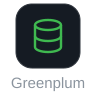
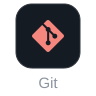
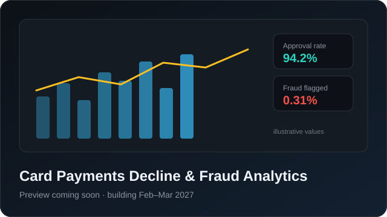
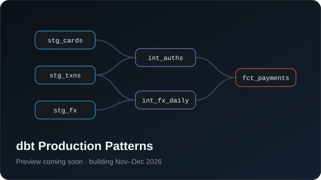

<p align="center">
  
</p>

<p align="center">
  <a href="https://www.linkedin.com/in/YOUR-LINKEDIN/"></a>
  &nbsp;
  <a href="mailto:usama.zia72@gmail.com"></a>
  &nbsp;
  <a href="Usama_Zia_Resume.pdf"></a>
</p>

<br>


## Toolbox

<table>
  <tr>
    <td align="center" width="110"><b>Build</b><br><sub>pipelines &amp; models</sub></td>
    <td>
      
      
      
      
      
    </td>
  </tr>
  <tr>
    <td align="center"><b>Store</b><br><sub>warehouses</sub></td>
    <td>
      
      
      
    </td>
  </tr>
  <tr>
    <td align="center"><b>Show</b><br><sub>dashboards</sub></td>
    <td>
      
      
    </td>
  </tr>
  <tr>
    <td align="center"><b>Ship</b><br><sub>team workflow</sub></td>
    <td>
      
      
      
    </td>
  </tr>
  <tr>
    <td align="center"><b>Next</b><br><sub>learning now</sub></td>
    <td>
      
      
      
      
    </td>
  </tr>
</table>

## Featured projects

<table>
  <tr>
    <td width="50%" valign="top">
      <a href="#"></a>
      <br><b>Card Payments Decline &amp; Fraud Analytics</b>
      <br><sub>Why do card payments get declined, and where is fraud hiding? An end-to-end pipeline from raw transactions to a dashboard.</sub>
      <br><br><code>Python</code> <code>Snowflake</code> <code>dbt</code> <code>Airflow</code> <code>Tableau</code>
    </td>
    <td width="50%" valign="top">
      <a href="#"></a>
      <br><b>dbt Production Patterns</b>
      <br><sub>How I structure a dbt project for a real team: layered models, reusable macros, incremental loads and tests on every model.</sub>
      <br><br><code>dbt</code> <code>DuckDB</code> <code>Snowflake</code>
    </td>
  </tr>
</table>

## Now building

```console
$ dbt build --select +usama_zia
1 of 4  OK   seven_years_of_fintech_data ............. [done]
2 of 4  RUN  dbt_analytics_engineering_certification . [Dec 2026]
3 of 4  RUN  snowpro_core_certification .............. [Jan 2027]
4 of 4  RUN  payments_fraud_analytics_platform ....... [Mar 2027]
```

<details>
<summary><b>Experience</b> · 7 years at i2c Inc., a global card-issuing and payments platform</summary>

<br>

| Role | Years | Highlights |
| :--- | :--- | :--- |
| **Senior Analytics Engineer** | 2024 – now | Automated 100+ hours of monthly reporting · moved pipelines to Airflow, about 4x faster · rebuilt reporting for 50+ enterprise clients |
| **Incident Team Lead** | 2019 – 2023 | Led 10+ analysts · 99% SLA adherence · 99.9% platform uptime |

**Education:** BS Information Technology, PUCIT Lahore (2019)

</details>

<br>

<p align="center">
  <b>Hiring for analytics or data engineering?</b><br>
  Open to remote roles and relocation. <a href="mailto:usama.zia72@gmail.com">Let's talk.</a>
</p>
